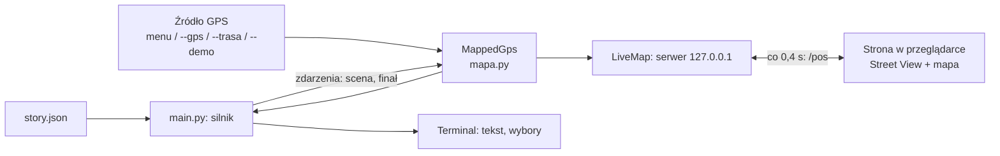

# Architektura: Mostek Czarownic

Stan na 2026-10-10. Prototyp leży w katalogu `terminal-game/` repozytorium. Dokument dla zespołu: jak zbudowany jest
prototyp, jak płyną dane i dlaczego podjęliśmy takie decyzje. Instrukcja uruchomienia
jest w [`README.md`](../README.md), format treści w [`FORMAT_HISTORII.md`](FORMAT_HISTORII.md),
postacie w [`HANDOFF_POSTACIE.md`](HANDOFF_POSTACIE.md).

## Cel

Przekazać wrocławską legendę tam, gdzie się wydarzyła. Turysta stoi pod kościołem
św. Marii Magdaleny, otwiera grę i w ciągu do 10 minut przechodzi krótki spacer
(kościół → pod wieże → Rynek), podejmując 6 decyzji. Na końcu dowiaduje się, jak jego
wersja ma się do prawdziwej legendy. Źródło legendy: [`LEGENDY.pdf`](../../docs/LEGENDY.pdf), rozdział 2.

To **prototyp w terminalu**: sprawdza treść, rozgałęzienia, logikę lokalizacji i spaceru,
zanim powstanie aplikacja na telefon. GPS jest symulowany, a Street View pokazuje
lokalna strona w przeglądarce.

## Składniki

| Plik | Rola |
|---|---|
| `story.json` | Cała treść i dane miejsca: graf scen, strefy, przystanki, trasa, panoramy Street View. Bez kodu. |
| `main.py` | Silnik gry (warunki tekstu, przejścia, punktacja, walidacja), lokalizacja (odległość, strefy, spacer), interfejs terminala i symulowane źródła GPS. Tylko biblioteka standardowa. |
| `mapa.py` | Podgląd na żywo: lokalny serwer HTTP ze stroną (Street View + mała mapa satelitarna), która śledzi pozycję z gry. Tylko biblioteka standardowa. |
| `test_game.py` | 53 testy: wszystkie ścieżki, punkty kluczowe, lokalizacja, spacer, podgląd, interfejs. |

Bez `--mapa` nakładki `MappedGps` i serwera nie ma: silnik pyta źródło GPS bezpośrednio.

## Przebieg gry

1. **Odblokowanie** (`play.unlock`): pozycja z GPS musi być w promieniu `unlock_radius_m`
   (250 m) od środka kościoła. Bez lokalizacji gra się nie zaczyna, a z daleka pokazuje
   „podejdź bliżej”. Blokada działa tylko na starcie.
2. **Strefa** (`locate`): najbliższy punkt widokowy w swoim promieniu (30 m) ustawia pole
   stanu `widok`, które zmienia pierwsze zdania („wieże masz po lewej”).
3. **Pętla scen**: od sceny `start` silnik pokazuje scenę, czeka na wybór, aktualizuje
   stan (`set`), pokazuje skutek i idzie do `next`. Scena z polem `before` najpierw
   wymaga dojścia do przystanku (`walk_to`).
4. **Koniec**: zakończenie wybrane polami `ending_by`, finał (widok z mostka),
   odsłonięcie imion, zestawienie „Twoja wersja a legenda” i wynik zgodności X/6.

### Źródła GPS

Silnik nie wie, skąd pochodzi pozycja. Woła `gps(cel)`, gdzie cel to przystanek
(albo `None` na starcie), i dostaje `(lat, lon)` albo `None`.

| Tryb | Klasa/funkcja | Zachowanie |
|---|---|---|
| domyślny | `menu_gps` | Przy każdym odczycie gracz wybiera punkt testowy z menu. |
| `--gps LAT,LON` | `menu_gps(first=...)` | Pierwsza pozycja z argumentu, potem menu. |
| `--trasa` | `RouteGps` | Odtwarza prawdziwą trasę pieszą co ok. 20 m (1 s na krok, `--tempo`). Atrybut `live = True`: spacer idzie sam, bez Entera. |
| `--demo` | `demo_gps` | Start pod wieżami, każdy przystanek zaliczony od razu. Do prezentacji. |
| `--no-gps` | `lambda: None` | Brak zgody na lokalizację: gra zablokowana. |

W aplikacji na telefon to miejsce zajmie prawdziwe `navigator.geolocation`.

### Podgląd na żywo (`--mapa`)

- `MappedGps` opakowuje źródło GPS: każdy odczyt zapisuje w `LiveMap` razem z wybranym
  ujęciem Street View i opisem („idziesz: …, jeszcze ok. 40 m”).
- `play(observer=...)` wysyła zdarzenia `scene` (baner fazy na stronie) i `finale`
  (przełączenie na panoramę z mostka).
- Strona odpytuje `/pos` co 0,4 s. Street View ładuje się w ukrytej ramce i dopiero
  potem podmienia, żeby obraz nie migał.

## Kluczowe decyzje

| Decyzja | Dlaczego | Koszt |
|---|---|---|
| **Treść w `story.json`, silnik w kodzie** | Pisarz zmienia historię bez programowania; ten sam plik może zasilić przyszłą aplikację. | Warunki tekstu są proste (pole ∈ wartości), bez wyrażeń. Celowo. |
| **Graf scen z punktami kluczowymi** | Wcześniej wybory zmieniały jedno zdanie (iluzja wyboru). Teraz drogi naprawdę się rozchodzą (3 drogi panny, 3 scenariusze na Rynku), a w punktach kluczowych (wyrok, Rynek) spotykają się w faktach z legendy. | Więcej treści do pisania: 10 scen zamiast 6. |
| **Każda ścieżka ma dokładnie 6 decyzji** | Przewidywalny czas gry (do 10 minut ze spacerem). | Nowe drogi muszą mieć tę samą długość; pilnuje tego walidacja. |
| **Wynik i fakty z legendy dopiero na końcu** | Ocena po każdym wyborze rozbijała opowieść. Zestawienie na końcu przekazuje legendę, nawet gdy ktoś grał zupełnie inaczej. | Gracz nie wie w trakcie, czy „trafia”. |
| **Bez imion do finału** | Narracja skupia się na miejscu; odsłonięcie imion na końcu działa jak zwrot akcji i zapada w pamięć razem z całą historią. | Trzeba pilnować tekstów (jest test). |
| **GPS zamiast zdjęcia z rozpoznawaniem obrazu** | Zdjęcia wymagały modelu AI (koszt, opóźnienie, przekłamania, prywatność), a GPS wystarcza, żeby wiedzieć, z której strony kościoła stoi gracz. | Kierunku patrzenia GPS nie daje, więc narracja mówi „stań twarzą do kościoła”. |
| **Pełna blokada bez lokalizacji** | Legenda „tylko na miejscu” to powód, żeby przyjść pod kościół. | Wymaga trybów `--demo` i `--trasa` do testów i prezentacji. |
| **Street View przez osadzenie bez klucza, tylko sprawdzone panoramy** | Działa od razu i bez kosztów. Osadzenie bierze najbliższą panoramę, a na trasie co piąta to zdjęcie użytkownika (np. nocne), więc w drodze pokazujemy wyłącznie 14 sprawdzonych oficjalnych panoram (`streetview.anchors`). | Obraz przeskakuje między panoramami; płynny ruch wymagałby Google Maps JavaScript API z kluczem. |
| **Mapillary odrzucone** | Sprawdzone 2026-10-10: brak zdjęć na Szewskiej, Św. Marii Magdaleny i Kurzym Targu. | — |
| **Tylko biblioteka standardowa** | Prototyp uruchamia się wszędzie bez instalacji (`python3 main.py`). | Prosty serwer HTTP zamiast frameworka. |

## Dane o miejscu i skąd pochodzą

Wszystkie współrzędne odczytano 2026-10-10 z Google Maps przez Playwright (prawy klik
na zdjęciu satelitarnym, trasa piesza, Street View):

- środek kościoła, 4 strefy widokowe, przystanek pod wieżami (ul. Szewska) i pręgierz;
- trasa piesza ok. 260 m: Św. Marii Magdaleny → róg Szewskiej → pod wieże → Kurzy Targ → pręgierz;
- 14 oficjalnych panoram Street View na trasie, ujęcia na przystankach i panorama
  „Bridge of Penitents” z samego mostka (zdjęcie użytkownika, autor: belu p. fly).

Ustalenie terenowe ważne dla narracji: wieże stoją od zachodu, przy Szewskiej,
a mostek łączy wieżę północną z południową. Od północy i południa widać go więc tylko
z boku, co tekst uwzględnia.

## Ograniczenia i następne kroki

- **Sprawdzić w terenie:** strefy, promienie (30 m) i ujęcia z północy i wschodu.
  Nie były oglądane w Street View.
- **Korekta tekstów:** polskich tekstów nie czytał korektor.
- **Postacie dopisane do gry** (czeladnik, kuzynka, stary kupiec) są spoza legendy.
  Opis i otwarte kwestie: [`HANDOFF_POSTACIE.md`](HANDOFF_POSTACIE.md).
- **Aplikacja na telefon:** obecna logika przenosi się 1:1. Front prowadzi grę
  według `story.json`, zamiast `menu_gps` używa geolokalizacji przeglądarki,
  a stronę z `mapa.py` zastępuje widok w aplikacji.
- **Backend:** szkic API w FastAPI (legendy, zapis gier przez interfejs do bazy
  w Postgresie) istnieje lokalnie jako `git stash` i nie jest częścią tej gałęzi.
- **Notatki z planowania** w `docs/zalozenia.txt` i `docs/ai_slop/` (w głównym katalogu repo) opisują pierwotny
  plan (PWA, FastAPI, Postgres, 3 legendy) i nie odzwierciedlają obecnego prototypu.
